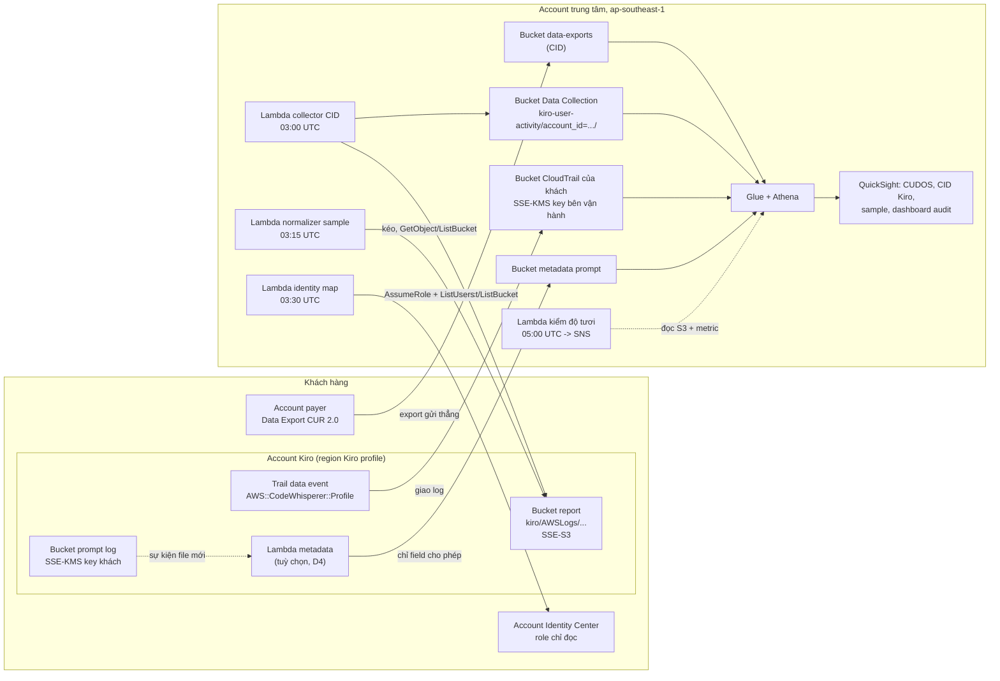
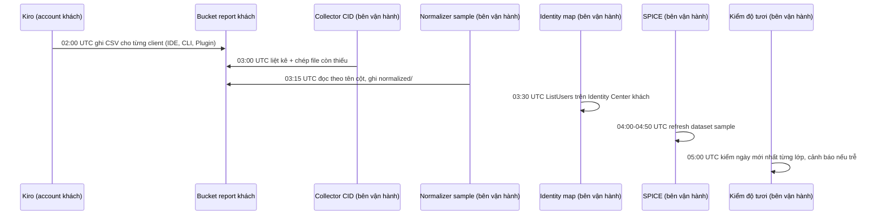

# Design: Theo dõi Kiro của khách hàng, xem tập trung ở account trung tâm

Tài liệu này trả lời câu hỏi "làm thế nào" cho các requirement trong `requirements.md`. Mỗi khẳng định kỹ thuật có một nhãn:
- **[ĐÃ ĐỌC]**: đọc trực tiếp trong tài liệu, có link ở mục 13.
- **[ĐÃ ĐO]**: đọc trong source code ở commit đã ghim, có ghi file và số dòng.
- **[CHƯA XÁC MINH]**: suy luận, hoặc tài liệu không nói. Mỗi chỗ như vậy có một câu hỏi mở OQ-n ở mục 11.

Chưa có lệnh nào thay đổi gì trên AWS. Ngày 2026-10-29 mọi profile CLI trên máy đều hết hạn, nên Price List API (OQ-8) và khảo sát (task 2.2, 2.3) chưa chạy được. OQ-10 và OQ-12 đã trả lời bằng cách đọc source của CID.

---

## 1. Tổng quan



Hướng mũi tên là hướng gọi API hoặc hướng dữ liệu đi. Các mũi tên "kéo" nghĩa là Lambda ở account trung tâm đọc bucket của khách, phía khách chỉ gắn bucket policy.

Sơ đồ có hai bản. `diagrams/kiro-customer-monitoring.drawio` là bản gọn một trang, mũi tên đánh số và chú giải bên dưới; bản này được chỉnh tay trong draw.io. `diagrams/kiro-customer-monitoring-chi-tiet.drawio` là bản chi tiết hai trang có ghi chú (kiến trúc và luồng dữ liệu, quyền truy cập xuyên account), được sinh từ `diagrams/build_architecture.py`. Script không bao giờ ghi vào bản gọn. Sau mỗi lần sửa, chạy `diagrams/verify_drawio.py` trên file vừa sửa.

**Vì sao phải kéo:** Kiro chỉ ghi report và prompt log vào bucket nằm ở account có user subscribe. Kiro ghi rõ không hỗ trợ bucket ở account khác. **[ĐÃ ĐỌC]**

## 2. Lịch chạy trong một ngày



- Giờ ghi report 02:00 UTC và giờ collector 03:00 UTC: **[ĐÃ ĐỌC]**.
- Giờ normalizer 03:15, identity map 03:30, SPICE 04:00: **[ĐÃ ĐO]** README của sample, dòng 133.
- Lịch refresh SPICE của CID: **[CHƯA XÁC MINH]**. Sau lần deploy đầu, chạy `cid-cmd refresh` bằng tay.
- 02:00 UTC là 09:00 giờ Việt Nam. Dữ liệu của ngày D xuất hiện trên dashboard khoảng 11:00 sáng ngày D+1, giờ Việt Nam.

## 3. Thành phần theo lớp

### 3.1 Lớp 1: CUR và CUDOS

| Thành phần | Account | Ai deploy | Cách deploy |
|---|---|---|---|
| Stack `CID-DataExports-Destination` | Bên vận hành | Người vận hành | Launch Stack hoặc CloudShell |
| Stack `CID-DataExports-Source`, hoặc export tạo tay | Payer của khách | Khách, hoặc người vận hành với profile của khách | Launch Stack |
| CUDOS | Bên vận hành | Người vận hành | `cid-cmd deploy` trong CloudShell |

Ràng buộc:
- Export do stack Source của CID tạo ghi vào prefix `cur2/<account nguồn>` trong bucket `<ResourcePrefix>-<account Data Collection>-data-exports` **[ĐÃ ĐO]** (`data-exports/deploy/data-exports-aggregation.yaml` dòng 691-693, commit `c747c93`). Bản trước của mục này ghi `<export-name>/<account nguồn>/...`, sai so với source. Đường dẫn bên dưới prefix đó (thư mục tên export, `data/`, `BILLING_PERIOD=YYYY-MM/`) là cách Data Exports tự đặt **[CHƯA XÁC MINH]**, kiểm lại bằng `list-objects-v2` sau lần giao đầu.
- Lần giao đầu mất khoảng 24 giờ, có thể tới 72 giờ. **[ĐÃ ĐỌC]**
- Backfill tối đa 14 tháng, account payer mở Support case. **[ĐÃ ĐỌC]**
- Data Exports chỉ có ở `us-east-1`. Khi deploy stack ở region khác, CloudFormation tạo export bằng custom resource. **[ĐÃ ĐỌC]**

**Lọc chỉ Kiro (D2):** query của Data Export hỗ trợ `WHERE` **[ĐÃ ĐỌC]**. Phương án là giữ đủ cột như export của CID, chỉ thêm `WHERE line_item_product_code = 'Kiro'`. Stack Source của CID tạo export với query cố định, nên phải tạo export lọc bằng tay hoặc bằng Terraform. Chưa biết CUDOS và CID có chạy đúng trên CUR đã lọc không (OQ-7).

**Resource ID trong CUR:** CID đếm license theo Identity Center user ID nằm trong `line_item_resource_id` **[ĐÃ ĐỌC]**. Vì vậy export phải bật "Include resource IDs". Export do CID tạo **có bật** **[ĐÃ ĐO]** (OQ-10): `INCLUDE_RESOURCES: "TRUE"` ở cả hai cách tạo export (`data-exports-aggregation.yaml` dòng 684 và 719), và cả 4 query CUR 2.0 của CID đều chọn cột `line_item_resource_id` (dòng 243-252). Nếu khách đã có export tự tạo, `tools/survey_customer.py` đọc hai điều này từ `get-export`.

### 3.2 Lớp 2: CID Kiro

| Thành phần | Account | Ghi chú |
|---|---|---|
| Data Collection Stack, chỉ bật `IncludeKiroUserActivityModule=yes` | Bên vận hành | Điền `KiroSourceBuckets` bằng tên bucket report của từng khách, ngăn cách bằng dấu phẩy |
| Dashboard `kiro-user-activity` | Bên vận hành | `cid-cmd deploy --dashboard-id kiro-user-activity` |
| Bucket policy cho `LambdaRoleArn` | Account Kiro của khách | Lấy nguyên từ output `BucketPolicyExample` |

Đo trong source module Kiro (`awslabs/cid-data-collection-framework`, nhánh `main`, ngày 2026-10-29, `data-collection/deploy/module-kiro-user-activity.yaml`):
- **[ĐÃ ĐO]** Module có tham số `KiroActivityPrefix`, mặc định `kiro/` (dòng 45-48). Nhưng stack chính `deploy-data-collection.yaml` (dòng 1634-1647) **không truyền tham số này**, chỉ truyền `KiroSourceBuckets` và `DataBucketsKmsKeysArns`. Nghĩa là deploy qua Data Collection Stack thì prefix luôn là `kiro/`, và mọi khách phải dùng chung prefix đó. Đây là lý do của Requirement 5.2.
- **[ĐÃ ĐO]** Collector đọc account, region và ngày từ đường dẫn object (dòng 315-333), liệt kê với `Prefix=f'{SOURCE_PREFIX}AWSLogs/'` (dòng 397), và chỉ lấy các key chứa `/KiroLogs/user_report/` (dòng 404). Như vậy thiết kế này đọc được account khác mà không phải sửa gì.
- **[ĐÃ ĐO]** Module có cấp `kms:Decrypt` trên các key nhận qua `DataBucketsKmsKeysArns` (dòng 151-159). Tuy vậy, tài liệu chính thức ghi SSE-KMS không được hỗ trợ **[ĐÃ ĐỌC]**. Thiết kế này coi SSE-KMS là không hỗ trợ và yêu cầu SSE-S3 (Requirement 5.3). Muốn dùng KMS thì phải thử riêng và khách phải sửa key policy.

### 3.3 Lớp 3: sample QuickSight, bản vá cho cross-account

Nguồn: `aws-samples/sample-kiro-user-analytics-quicksight-dashboard`, commit `1f5f5b8d1ffe84776c4d8005eb0cdaf31e3882f5` (2026-10-09).

Những điểm đã đo trong source:
- **[ĐÃ ĐO]** `cfn/01-data-layer.yaml` dòng 313: `RAW_PREFIX: !Sub "${KiroLogsPrefix}AWSLogs/${AWS::AccountId}/KiroLogs/user_report/"`. Đây là chỗ duy nhất ghim account vào đường dẫn mà Lambda đọc.
- **[ĐÃ ĐO]** `scripts/normalize_report_lambda.py` lấy đường dẫn từ biến môi trường `RAW_PREFIX` (dòng 315) rồi liệt kê với `Prefix=prefix` (dòng 233). Bản thân Lambda không ghim account.
- **[ĐÃ ĐO]** Role normalizer cấp `s3:GetObject` và `s3:ListBucket` theo tên bucket (dòng 241-249), không ghim account.
- **[ĐÃ ĐO]** Bảng Athena của sample trỏ vào bucket kết quả `normalized/facts/` và `normalized/models/` (`scripts/build_views.py` dòng 93-94), không trỏ vào bucket của khách. Vì vậy bucket của khách không cần cấp quyền cho QuickSight.
- **[ĐÃ ĐO]** `deploy.sh` chỉ dò đường dẫn mang account (dòng 250) khi `KIRO_LOGS_PREFIX` **không được đặt**. Đặt sẵn `KIRO_LOGS_PREFIX="kiro/"` thì bước dò bị bỏ qua.
- **[ĐÃ ĐO]** `preflight.sh` dòng 168 dò đường dẫn mang account đang deploy, bằng credential của người chạy script, và báo `fail` nếu không thấy (dòng 205).
- **[ĐÃ ĐO]** Bước gọi normalizer trong `deploy.sh` không chặn deploy khi lỗi (dòng 427). Vì vậy phải tự đọc kết quả gọi normalizer sau khi deploy.
- **[ĐÃ ĐO]** Lambda identity map gọi `sts.assume_role(RoleArn=..., RoleSessionName="kiro-identity-map")` mà **không truyền ExternalId** (`scripts/identity_map_lambda.py` dòng 62-65).
- **[ĐÃ ĐO]** `STACK_PREFIX` dài tối đa 20 ký tự. Tên Glue database là `STACK_PREFIX` với `-` đổi thành `_` (`deploy.sh` dòng 93-104).
- **[ĐÃ ĐO]** Sample có sẵn SNS topic và hai alarm `normalizer-errors`, `normalizer-not-running` (`cfn/01-data-layer.yaml` dòng 347-399), cùng tham số `AlarmEmail` (dòng 62). Tôi chưa đọc điều kiện để topic gửi email.

Ba bản vá, đều giữ nguyên hành vi gốc khi không truyền tham số mới:

**P1. Account nguồn cho đường dẫn report** (`cfn/01-data-layer.yaml`, `scripts/deploy.sh`)
```diff
 Parameters:
+  SourceAccountId:
+    Type: String
+    Default: ""
+    AllowedPattern: "^$|^[0-9]{12}$"
+    Description: Account that owns the Kiro report. Empty means this account.
+Conditions:
+  HasSourceAccount: !Not [!Equals [!Ref SourceAccountId, ""]]
 ...
-      RAW_PREFIX: !Sub "${KiroLogsPrefix}AWSLogs/${AWS::AccountId}/KiroLogs/user_report/"
+      RAW_PREFIX: !Sub
+        - "${KiroLogsPrefix}AWSLogs/${Acct}/KiroLogs/user_report/"
+        - Acct: !If [HasSourceAccount, !Ref SourceAccountId, !Ref "AWS::AccountId"]
```
Trong `deploy.sh`, thêm `KIRO_SOURCE_ACCOUNT_ID="${KIRO_SOURCE_ACCOUNT_ID:-}"`. Truyền `SourceAccountId=${KIRO_SOURCE_ACCOUNT_ID}` vào **cả hai** khối `--parameter-overrides` của data stack (dòng 320 và 340). Hàm `probe_prefix` (dòng 250) dùng `${KIRO_SOURCE_ACCOUNT_ID:-$ACCOUNT_ID}`.

Nếu `Conditions:` đã có trong template thì thêm điều kiện vào khối hiện có, không tạo khối thứ hai.

**P2. Preflight khi cross-account** (`scripts/preflight.sh`)
Khi `KIRO_SOURCE_ACCOUNT_ID` khác rỗng và khác `ACCOUNT_ID`, đổi bước kiểm ở dòng 168-207 thành cảnh báo: "bucket thuộc account khác, người chạy script không có quyền list, sẽ kiểm qua kết quả normalizer". Không cấp quyền list bucket của khách cho role của người deploy.

**P3. ExternalId cho identity map** (`scripts/identity_map_lambda.py`, `cfn/03-identity-mapping.yaml`, `scripts/deploy.sh`)
```diff
-    creds = sts.assume_role(
-        RoleArn=role_arn,
-        RoleSessionName="kiro-identity-map",
-    )["Credentials"]
+    kwargs = {"RoleArn": role_arn, "RoleSessionName": "kiro-identity-map"}
+    external_id = os.environ.get("IDC_EXTERNAL_ID", "").strip()
+    if external_id:
+        kwargs["ExternalId"] = external_id
+    creds = sts.assume_role(**kwargs)["Credentials"]
```
Thêm tham số `IdcExternalId` (mặc định rỗng) vào template, truyền vào biến môi trường `IDC_EXTERNAL_ID`. Trong `deploy.sh`, đọc `IDC_EXTERNAL_ID` rồi truyền vào stack identity map.

ExternalId không phải bí mật. Nó chỉ cần duy nhất cho mỗi khách, nên dùng `kiro-mon-<khách>-<8 ký tự ngẫu nhiên>`.

**Cách vá:** chép repo nguyên trạng vào `vendor/`, ghi lại SHA256 của từng file sẽ sửa, chỉ sửa đúng các dòng nêu trên, rồi chạy unit test trước và sau khi vá (Requirement 7.4). Không gõ lại logic có sẵn.

**Unit test mới cần thêm:**
- `RAW_PREFIX` render đúng trong cả hai trường hợp có và không có `SourceAccountId`. Kiểm bằng `cfn-lint` cộng một test đọc YAML.
- `_idc_client` truyền `ExternalId` khi có biến, và không truyền khi biến rỗng. Mock `sts`.

### 3.4 Lớp 4: CloudTrail data events

| Thành phần | Account | IaC |
|---|---|---|
| Trail `kiro-mon-audit` | Account Kiro của khách, region Kiro profile | `infra/customer/trail` (Terraform) |
| Bucket `kiro-mon-trail-<khách>-<observability-account-id>` | Bên vận hành, region **[CHƯA XÁC MINH]** (xem dưới) | `infra/observability/trail-bucket` |
| KMS key `alias/kiro-mon-trail-<khách>` | Bên vận hành | như trên |
| Bảng Athena `kiro_<khách>.cloudtrail_kiro` | Bên vận hành | như trên |

Advanced event selector của trail:
```json
[
  {
    "Name": "kiro-profile-data-events",
    "FieldSelectors": [
      { "Field": "eventCategory", "Equals": ["Data"] },
      { "Field": "resources.type", "Equals": ["AWS::CodeWhisperer::Profile"] }
    ]
  }
]
```
- Không có selector nào cho management event, nên trail không ghi management event.
- Sau OQ-1, nếu cần, thêm `{ "Field": "eventName", "Equals": [...] }`.
- Loại `AWS::CodeWhisperer::Profile` có trong bảng data event của CloudTrail **[ĐÃ ĐỌC]**. Kiro có sinh event loại này không là OQ-1.

Statement chính trong bucket policy phía vận hành:
```json
{
  "Sid": "CloudTrailWriteFromCustomerTrail",
  "Effect": "Allow",
  "Principal": { "Service": "cloudtrail.amazonaws.com" },
  "Action": "s3:PutObject",
  "Resource": "arn:aws:s3:::kiro-mon-trail-<khách>-<observability-account-id>/AWSLogs/<account Kiro khách>/*",
  "Condition": {
    "StringEquals": {
      "s3:x-amz-acl": "bucket-owner-full-control",
      "aws:SourceArn": "arn:aws:cloudtrail:<region Kiro>:<account Kiro khách>:trail/kiro-mon-audit"
    }
  }
}
```
Cần thêm statement `s3:GetBucketAcl` cho cùng principal và cùng điều kiện `aws:SourceArn`, theo mẫu trong tài liệu CloudTrail cho nhiều account **[ĐÃ ĐỌC]**. Key policy của KMS cho phép `cloudtrail.amazonaws.com` mã hoá với điều kiện `aws:SourceArn` đó.

**Region của bucket:** trail ở account khách nằm ở `us-east-1` hoặc `eu-central-1`, còn QuickSight của bên vận hành ở `ap-southeast-1`. Có hai lựa chọn:
- Đặt bucket ở region của trail. Athena ở `ap-southeast-1` sẽ đọc S3 khác region và tốn phí truyền dữ liệu.
- Đặt bucket ở `ap-southeast-1`.

CloudTrail có cho trail ghi vào bucket khác region không: **[CHƯA XÁC MINH]** (OQ-11). Tôi nghiêng về bucket ở `ap-southeast-1` nếu được phép, vì toàn bộ query chạy ở đó.

Bảng Athena dùng partition projection theo `region`, `year`, `month`, `day` trên đường dẫn `AWSLogs/<account>/CloudTrail/<region>/<yyyy>/<mm>/<dd>/`. Không dùng crawler.

### 3.5 Lớp 5: prompt logging

| Thành phần | Account | IaC |
|---|---|---|
| Bucket `<khách>-kiro-prompt-logs` | Account Kiro của khách, region Kiro profile | `infra/customer/prompt-logs` |
| KMS key của khách | như trên | như trên |
| Bảng Athena và role `kiro-prompt-auditor` | như trên | như trên |
| Lambda metadata (chỉ khi D4 = có) | như trên | `infra/customer/prompt-metadata` |
| Bucket `kiro-mon-promptmeta-<khách>-<observability-account-id>` | Bên vận hành | `infra/observability/prompt-metadata` |

- Bucket policy cho Kiro ghi theo mẫu tài liệu: principal `q.amazonaws.com`, `s3:PutObject`, điều kiện `aws:SourceAccount` và `aws:SourceArn` dạng `arn:aws:codewhisperer:<region>:<account>:*` **[ĐÃ ĐỌC]**.
- Prompt log có dùng KMS key được: tài liệu Kiro nhắc tới phí của KMS key tuỳ chọn **[ĐÃ ĐỌC]**. Tài liệu không nêu key policy cụ thể cho `q.amazonaws.com`. Phải thử ở OQ-9 trước khi áp cho khách.
- Chưa đo độ trễ từ lúc chat tới lúc file prompt log xuất hiện (OQ-9).

**Metadata prompt: danh sách field được phép.** Đây là danh sách trắng. Field nào không có tên ở đây thì không được ra khỏi account khách.

| Field ra | Lấy từ | Kiểu |
|---|---|---|
| `record_type` | `chat` hoặc `inline`, tuỳ khoá `generateAssistantResponseEventRequest` hay `generateCompletionsEventRequest` | string |
| `request_id` | `...EventResponse.requestId` | string |
| `conversation_id` | `generateAssistantResponseEventResponse.messageMetadata.conversationId` (chỉ chat) | string, có thể rỗng |
| `utterance_id` | `messageMetadata.utteranceId` | string, có thể rỗng |
| `user_id` | `...EventRequest.userId` | string |
| `event_ts` | `...EventRequest.timeStamp` | timestamp UTC |
| `chat_trigger_type` | `chatTriggerType` (chỉ chat) | string |
| `customization_arn_present` | `customizationArn` khác null hay không | boolean |
| `prompt_chars` | độ dài `prompt`, hoặc độ dài `leftContext` cộng `rightContext` với inline | int |
| `response_chars` | độ dài `assistantResponse`, hoặc tổng độ dài `completions` với inline | int |
| `web_link_count`, `code_reference_count` | số phần tử trong `supplementaryWebLinksEvent`, `codeReferenceEvents` | int |
| `source_key_sha256` | SHA256 của S3 key nguồn, dùng để truy vết mà không lộ đường dẫn | string |

Các tên field nguồn ở trên **[ĐÃ ĐỌC]** trong ví dụ prompt log của tài liệu Kiro. Không có field nào trong bảng mang nội dung. `fileName` bị loại vì tên file có thể lộ cấu trúc mã nguồn. Lambda đọc file JSON, ghi một dòng JSON Lines cho mỗi record sang bucket bên vận hành, đường dẫn `promptmeta/account_id=<id>/dt=<yyyy-mm-dd>/`.

### 3.6 Nối dữ liệu và dashboard audit

View `kiro_<khách>.kiro_request_audit`:

| Cột | Nguồn | Ghi chú |
|---|---|---|
| `event_time` | CloudTrail `eventTime` | |
| `event_name` | CloudTrail `eventName` | danh sách thật lấy từ OQ-1 |
| `request_id` | CloudTrail `requestID` | |
| `error_code`, `error_message_present` | CloudTrail `errorCode`, `errorMessage` khác null | chỉ lưu có hay không có thông báo lỗi |
| `account_id`, `region` | CloudTrail `recipientAccountId`, `awsRegion` | |
| `user_id` | CloudTrail, field cụ thể chờ OQ-3 (giả thuyết: `userIdentity.onBehalfOf.userId`) | khoá nối |
| `user_label` | identity map của sample (lớp 3), dự phòng bằng email trong report | |
| `client` | rút từ `userAgent` (IDE hay CLI và phiên bản) | không nạp toàn chuỗi vào SPICE |
| `conversation_id`, `prompt_chars`, `response_chars` | metadata prompt, nối theo `request_id` | chỉ khi D4 = có và OQ-2 = trùng |

Nối user ID:
- Prompt log có user ID dạng `d-xxxxxxxxxx.<uuid>` **[ĐÃ ĐỌC]**, tức Identity Store ID và user UUID ghép bằng dấu chấm. Cách tách này tôi suy ra từ ví dụ.
- Sample ghi rằng user ID trong report là user UUID của Identity Store **[ĐÃ ĐO]** (README dòng 404).
- Khoá nối dự kiến là phần UUID sau dấu chấm. OQ-3 sẽ xác nhận.

Dashboard `Kiro Request Audit - <khách>` dựng bằng Terraform (`aws_quicksight_data_set`, `aws_quicksight_dashboard`), dataset SPICE từ view trên. `sourceIPAddress` không nằm trong view, chỉ role audit query bảng gốc khi cần (Requirement 12.5).

Không thêm tab vào dashboard của CID hay sample: `cid-cmd update` và việc chạy lại `deploy.sh` của sample dựng lại định nghĩa dashboard **[CHƯA XÁC MINH]**, nên phần sửa tay có thể bị ghi đè.

### 3.7 Kiểm độ tươi và cảnh báo

Lambda `kiro-mon-freshness` ở account trung tâm chạy theo EventBridge Scheduler lúc 05:00 UTC. Lambda chỉ đọc S3 và CloudWatch, không gọi Athena, nên không tốn tiền query:

| Kiểm | Cách đo | Ngưỡng |
|---|---|---|
| Report qua CID | Partition `day=` mới nhất dưới `kiro-user-activity/account_id=<khách>/` trong bucket Data Collection | trễ quá 2 ngày |
| Report qua sample | Partition `export_date=` mới nhất dưới `normalized/facts/` trong bucket kết quả của từng bản sample | trễ quá 2 ngày |
| Collector CID | Metric `AWS/Lambda Errors` của `CID-DC-kiro-user-activity-Lambda` trong 24 giờ, cộng một truy vấn Logs Insights tìm `AccessDenied` | lớn hơn 0 |
| CloudTrail | `LastModified` của object mới nhất dưới `AWSLogs/<khách>/CloudTrail/` | quá 24 giờ |
| Metadata prompt | Partition `dt=` mới nhất | quá 2 ngày, nếu D4 = có |
| CUR | Object mới nhất dưới `cur2/<account payer>/<export-name>/data/BILLING_PERIOD=<tháng này hoặc tháng trước>/` trong bucket data-exports (đoạn sau `cur2/<account payer>/` cấu hình được, xem mục 3.1) | chưa có file sau 72 giờ kể từ khi tạo export, hoặc file mới nhất cũ hơn 3 ngày |

- Tên Lambda collector `CID-DC-kiro-user-activity-Lambda` lấy theo tài liệu CID **[ĐÃ ĐỌC]**.
- **Collector không bao giờ làm metric `Errors` tăng khi lỗi truy cập** **[ĐÃ ĐO]** (OQ-12, `module-kiro-user-activity.yaml` commit `c747c93`). Lỗi của từng file và lỗi khi liệt kê bucket đều bị bắt vào danh sách `errors` (dòng 435-438). Hàm vẫn trả `statusCode: 200` và in một dòng JSON gồm `total_files_copied`, `total_rows_written`, `partitions_registered`, `errors` (tối đa 20 phần tử, dòng 440-447). Vì vậy dòng "Collector CID" ở bảng trên phải đọc dòng JSON đó bằng `logs:FilterLogEvents`, không chỉ dựa vào metric. Mỗi phần tử lỗi bắt đầu bằng `<bucket>/<key>:` hoặc `Error listing <bucket>:`, nên gán được lỗi cho từng khách theo tên bucket. Cảnh báo chỉ ghi số lỗi và số `AccessDenied`, không chép chuỗi lỗi.
- Cảnh báo gửi tới SNS `kiro-mon-alerts`. Nội dung chỉ có tên khách, lớp, ngày mới nhất và số đếm.
- Ngưỡng 2 ngày, vì report ngày D có lúc 02:00 UTC ngày D+1 và collector chạy lúc 03:00 UTC.
- Lớp 3 còn có hai alarm sẵn của sample, xem mục 3.3.

## 4. IAM và bucket policy phía khách

Bucket policy của bucket report, ở account Kiro của khách:
```json
[
  {
    "Sid": "KiroMonReportRead",
    "Effect": "Allow",
    "Principal": { "AWS": [
      "<LambdaRoleArn từ output CID>",
      "arn:aws:iam::<observability-account-id>:role/<role normalizer của bản sample kiro-<khách>>"
    ]},
    "Action": "s3:GetObject",
    "Resource": "arn:aws:s3:::<bucket report>/kiro/*"
  },
  {
    "Sid": "KiroMonReportList",
    "Effect": "Allow",
    "Principal": { "AWS": [ "<cùng hai ARN>" ] },
    "Action": "s3:ListBucket",
    "Resource": "arn:aws:s3:::<bucket report>",
    "Condition": { "StringLike": { "s3:prefix": "kiro/*" } }
  }
]
```
- Normalizer liệt kê với prefix `kiro/AWSLogs/<account>/KiroLogs/user_report/`, nằm trong điều kiện `kiro/*`.
- Bucket policy lưu role theo unique ID **[ĐÃ ĐỌC]**. Khi role bị tạo lại (deploy lại CID, hoặc teardown rồi deploy lại sample) thì phải gắn lại policy.

Role đọc Identity Center ở account Identity Center của khách:
- Tên `kiro-mon-idc-read-<khách>`.
- Trust: principal đúng ARN role Lambda identity map, điều kiện `sts:ExternalId`.
- Quyền: `identitystore:ListUsers` trên `arn:aws:identitystore::<account>:identitystore/<d-...>` và `arn:aws:identitystore:::user/*`. Đây đúng cặp resource mà sample dùng cho trường hợp cùng account **[ĐÃ ĐO]** (`cfn/03-identity-mapping.yaml` dòng 287-290).

## 5. Phân loại dữ liệu và nơi lưu

| Dữ liệu | Có chứa | Nằm ở | Ai đọc ở bên vận hành |
|---|---|---|---|
| CUR | chi phí, usage type, resource ID (gồm Identity Center user ID của người dùng Kiro) | Bên vận hành | QuickSight, role FinOps |
| Report | user ID, email (thường trống theo README sample), tier, credit, message theo model, client | Khách, kèm bản sao ở bên vận hành | Collector, normalizer, QuickSight |
| Identity map | username, tên hiển thị, email | Bucket SSE-KMS riêng của sample ở bên vận hành, cộng SPICE | Lambda identity map, QuickSight |
| CloudTrail | user ID, IP nguồn, user agent, request ID, mã lỗi | Bên vận hành, SSE-KMS | Role audit (bảng gốc), QuickSight (chỉ view đã lược) |
| Prompt log | toàn văn | Chỉ ở khách | Không ai |
| Metadata prompt | ID, thời điểm, độ dài | Bên vận hành (khi D4 = có) | Role audit, QuickSight |

Thời gian giữ ở bên vận hành chờ quyết định D5. Đề xuất 13 tháng cho CloudTrail và metadata prompt. Dữ liệu CID giữ theo mặc định của CID.

## 6. Cấu trúc thư mục dự án

```
kiro-monitoring\
  .kiro\specs\kiro-customer-monitoring\   requirements.md, design.md, tasks.md
  .gitignore                              customers/, *.tfstate*, .terraform/, vendor/**/.venv
  docs\RUNBOOK.md, TEARDOWN.md, data-inventory-template.md
  customers\<khách>\                      (gitignore) config.json, data-inventory.md, SURVEY.md, BASELINE.md, terraform.tfvars
  tools\survey_customer.py                khảo sát chỉ đọc (Requirement 2)
  tools\measure_oq.py                     đo OQ-1 đến OQ-4, chỉ in số đếm và độ dài
  tools\reconcile.py                      đối chiếu số (Requirement 16)
  tools\scan_staged.py                    secret scan trên file đã stage
  infra\observability\                           Terraform: trail-bucket, prompt-metadata, audit-views, audit-dashboard, freshness
  infra\customer\                         Terraform: trail, prompt-logs, prompt-metadata, idc-read-role, report-bucket-policy
  vendor\sample-kiro-user-analytics-quicksight-dashboard\   bản đã vá P1-P3
```

Mỗi khách có một Terraform state riêng cho mỗi account: `customers/<khách>/state-observability` và `customers/<khách>/state-customer`. Với cả hai account, `provider` dùng `allowed_account_ids` để Terraform từ chối chạy nhầm account.

## 7. Xử lý lỗi

| Tình huống | Dấu hiệu | Xử lý |
|---|---|---|
| Bucket policy phía khách trỏ về role cũ | Collector trả `total_files_copied: 0`, freshness báo trễ | Gắn lại policy từ output `BucketPolicyExample` mới (Requirement 6.6) |
| Bucket report bị đổi sang SSE-KMS | Collector lỗi `AccessDenied` khi `GetObject` | Đổi lại SSE-S3 cho prefix `kiro/` |
| Khách đổi S3 location của report | Freshness báo trễ, prefix cũ vẫn còn file | Cập nhật SURVEY, xác nhận prefix `kiro/` |
| Kiro thêm model mới | Có cột `<model>_messages` mới | Không cần làm gì: normalizer đọc theo tên cột **[ĐÃ ĐỌC]** README sample |
| CUR chưa về sau 72 giờ | Không có file dưới `<export>/<payer>/` | Kiểm export ở account payer, kiểm bucket policy của Data Exports |
| Trail giao lỗi | `LatestDeliveryError` khác rỗng | Kiểm bucket policy, key policy, điều kiện `aws:SourceArn` |
| Record prompt log có cấu trúc lạ | Metric `SkippedRecords` lớn hơn 0 | Không ghi nội dung ra log. Lấy record mẫu từ phía khách, cập nhật schema |
| Terraform chạy nhầm account | `allowed_account_ids` chặn ở bước plan | Dừng, kiểm profile |

## 8. Chiến lược kiểm thử

**Unit test, không cần AWS:**
- Unit test có sẵn của sample, chạy trước và sau khi vá. Số test pass không được giảm.
- Test cho P1 và P3 như mục 3.3.
- Lambda metadata: dùng hai record mẫu trong tài liệu Kiro (chat và inline). Kiểm output chỉ có các khoá trong danh sách trắng, và không chứa chuỗi con nào dài từ 8 ký tự trở lên lấy từ các field toàn văn của input. Thêm một test với record lạ để kiểm record bị bỏ và log không chứa nội dung.
- Lambda freshness: mock S3 và CloudWatch, kiểm ngưỡng 2 ngày và 24 giờ.
- `tools/scan_staged.py`: kiểm bắt được số 12 chữ số, chuỗi `d-` theo sau là 10 ký tự, và tên khách có trong `customers/*/config.json`.

**Kiểm tĩnh:**
- `terraform validate` và `terraform plan` cho từng root module. Plan phải đọc được, không có resource nằm ngoài danh sách mong đợi.
- `cfn-lint` trên template đã vá của sample.

**Kiểm bằng đo sau deploy** (Requirement 16). Mỗi số đo bằng một công cụ khác với công cụ đã tạo ra dữ liệu đó:

| Kiểm | Cách 1 | Cách 2 |
|---|---|---|
| Phí Kiro theo tháng | Athena trên bảng CUR | Cost Explorer ở account payer của khách |
| Số user distinct | Athena trên bảng CID | Athena trên view của sample |
| Ngày sớm nhất của report | Athena | `s3api list-objects-v2` trên bucket của khách (lúc khảo sát) |
| Có log CloudTrail | Athena đếm event | `get-trail-status` và `list-objects-v2` |
| Không có toàn văn ở bên vận hành | Grep tên field toàn văn trên mẫu object trong bucket metadata | Unit test danh sách trắng |

## 9. Chi phí cho mỗi khách (ước lượng)

| Khoản | Account chịu | Ước lượng | Nguồn |
|---|---|---|---|
| Pipeline sample | Bên vận hành | khoảng 0,05 USD/tháng | Số đo 30 ngày trong README sample |
| KMS key identity map | Bên vận hành | 1 USD/tháng, key vẫn còn sau teardown | README sample |
| KMS key bucket CloudTrail | Bên vận hành | 1 USD/tháng cộng phí request | Giá KMS **[CHƯA XÁC MINH]** lượt này |
| Lưu CUR | Bên vận hành | dưới 10 USD/tháng với tổ chức cỡ vừa | Tài liệu CID |
| CloudTrail data event | Khách (người sở hữu trail) | khoảng 0,10 USD cho 100.000 event, nhân với số event | **[CHƯA XÁC MINH]**: đơn giá (OQ-8) và số event (OQ-1) |
| Prompt log, KMS key của khách | Khách | phí S3 và KMS | Tài liệu Kiro |
| QuickSight reader | Bên vận hành | khoảng 3 USD/reader/tháng (suy từ README: 1 author + 25 reader = 99 USD) | README sample |
| Phí 250 USD/tháng của QuickSight | Account trung tâm | chỉ phát sinh khi account có user Pro hoặc đã bật Amazon Q in QuickSight, kiểm ở task 2.3 | README sample |

Lưu ý:
- Phí CloudTrail tính cho account sở hữu trail, tức account khách. Phải ghi điều này trong báo giá.
- Khoản dễ đội nhất là số reader QuickSight. Chỉ cấp quyền theo danh sách ở D1.

## 10. Quyết định cần chốt

| # | Câu hỏi | Lựa chọn | Đề xuất và lý do |
|---|---|---|---|
| D1 | Ai xem dashboard | (a) Chỉ người bên vận hành. (b) Cả khách | **(a)** cho giai đoạn đầu. (b) cần user QuickSight cho khách ở account trung tâm cộng row-level security theo `account_id`, tức thêm chi phí reader và thêm một lớp kiểm |
| D2 | CUR toàn bộ hay chỉ Kiro | (a) Toàn bộ. (b) Chỉ Kiro | **(b)** nếu OQ-7 qua: bên vận hành chỉ cần chi phí Kiro, và ít dữ liệu nhạy cảm hơn. Nếu OQ-7 không qua thì (a) kèm văn bản đồng ý ghi rõ toàn bộ chi phí |
| D3 | Lớp 3 đặt ở đâu | (a) Account trung tâm, vá P1-P3. (b) Account khách, không vá | **(a)**, đúng mục tiêu xem tập trung. Bản vá nhỏ và giữ hành vi gốc khi không truyền tham số |
| D4 | Chuyển metadata prompt về bên vận hành | (a) Không. (b) Có | **(a)** cho tới khi có OQ-2. Nếu request ID không trùng thì metadata chỉ nối được theo user và ngày, giá trị thêm vào thấp |
| D5 | Thời gian giữ ở bên vận hành | | **13 tháng** cho CloudTrail và metadata, để so được cùng kỳ năm trước |
| D6 | Account và region nhận | | **`<observability-account-id>`, `ap-southeast-1`**, nơi QuickSight đã chạy |
| D7 | Account dùng để đo OQ-1 đến OQ-4 | (a) Account trung tâm có user Kiro. (b) Account khách | **(a)** nếu khảo sát thấy bên vận hành có user Kiro, để không tạo resource thử trên account khách |
| D8 | Bật identity mapping | (a) Có. (b) Không | **(a)**, vì README sample ghi cột email trong report thường trống, nếu tắt thì dashboard chỉ hiện GUID. Cần khách đồng ý cho chuyển tên và email |

## 11. Câu hỏi mở

| # | Câu hỏi | Chặn task | Cách trả lời |
|---|---|---|---|
| OQ-1 | Kiro có sinh data event `AWS::CodeWhisperer::Profile` không, có những `eventName` nào, một câu chat ra bao nhiêu event | Toàn bộ lớp 4 | Trail tạm, chat thử, đếm (task 3) |
| OQ-2 | `requestID` của CloudTrail có trùng `requestId` của prompt log không | Nối lớp 4 với lớp 5, D4 | Như OQ-1, đo tỷ lệ trùng |
| OQ-3 | User ID trong report, CloudTrail và prompt log có cùng định dạng không, field nào trong CloudTrail chứa user | View audit | Như OQ-1, chỉ in độ dài, tiền tố và vị trí dấu chấm |
| OQ-4 | Request lỗi hoặc bị từ chối có được ghi ở CloudTrail và prompt log không | Chọn nguồn làm danh sách request đầy đủ | Như OQ-1, cố ý tạo một request lỗi nếu làm được |
| OQ-5 | Bucket report của khách mã hoá kiểu gì, prefix nào, report sớm nhất ngày nào | Lớp 2, 3 | Khảo sát (task 2) |
| OQ-6 | Khách đã có CUR chưa, ở account nào, từ tháng nào, có resource ID không | Lớp 1, 2 | Khảo sát |
| OQ-7 | CUDOS và CID có chạy đúng trên CUR chỉ còn dòng Kiro không | D2 | Thử trên account trung tâm: tạo export lọc, deploy CUDOS và CID trên đó, so với export đầy đủ |
| OQ-8 | Đơn giá CloudTrail data event ở region Kiro profile | Báo giá | Price List API, `ServiceCode=AWSCloudTrail` |
| OQ-9 | Prompt log có ghi được vào bucket SSE-KMS không, cần key policy gì, độ trễ bao lâu | Lớp 5 | Bucket tạm có KMS, chat thử, đo thời gian |
| OQ-10 | Export CUR của CID có bật resource ID không | Đếm license của CID | **Đã đo 2026-10-29: có.** `INCLUDE_RESOURCES: "TRUE"`, `data-exports-aggregation.yaml` dòng 684 và 719 (mục 3.1) |
| OQ-11 | Trail ở `us-east-1` có ghi vào bucket ở `ap-southeast-1` được không | Region của bucket CloudTrail | Đọc tài liệu CloudTrail, thử bằng trail tạm |
| OQ-12 | Collector CID có ghi lỗi truy cập ra CloudWatch Logs không | Cảnh báo collector | **Đã đo 2026-10-29: có, nhưng chỉ trong dòng JSON kết quả, không làm tăng metric `Errors`.** `module-kiro-user-activity.yaml` dòng 435-447 (mục 3.7) |
| OQ-13 | Lịch refresh SPICE của dataset CID Kiro | Giờ dữ liệu có trên dashboard | Đọc dataset sau khi `cid-cmd deploy` |

## 12. Phương án đã cân nhắc và không chọn

| Phương án | Lý do không chọn |
|---|---|
| Kiro ghi report thẳng vào bucket bên vận hành | Kiro không hỗ trợ bucket ở account khác **[ĐÃ ĐỌC]** |
| S3 replication từ bucket của khách sang bên vận hành | Khách phải bật versioning và tạo replication role. Replication chỉ chép object mới, file cũ cần Batch Replication. CID đã chuyển từ kiến trúc replication sang kéo **[ĐÃ ĐỌC]** (ghi chú teardown về prefix `kiro/` cũ) |
| Gom nhiều khách vào một bản sample | Sample không có cột account, dữ liệu sẽ trộn. Ngoài ra `RAW_PREFIX` chỉ nhận một account |
| Kéo toàn văn prompt về bên vận hành | Bên vận hành sẽ giữ mã nguồn và nội dung trao đổi của khách. Phạm vi đồng ý và rủi ro lớn hơn nhiều so với giá trị của audit |
| Trail có cả management event | Lớp 4 không cần. Nếu khách đã có trail ghi management event thì bản sao thứ hai bị tính phí |
| Thêm tab vào dashboard CID hoặc sample | Có thể bị ghi đè khi cập nhật (mục 3.6) |
| Cấp quyền list bucket của khách cho người deploy để preflight chạy được | Mở thêm một principal là người dùng thật. Kết quả gọi normalizer đã là phép kiểm tốt hơn (P2) |
| Coding metrics collector | Phải cài plugin trên từng máy developer, không quản lý tập trung được |

## 13. Nguồn

- [CID Kiro: kiến trúc kéo, khách chỉ gắn bucket policy](https://docs.aws.amazon.com/guidance/latest/cloud-intelligence-dashboards/kiro-user-activity-dashboard.html#:~:text=Customers%20only%20need%20to%20apply%20a%20bucket%20policy)
- [CID Kiro: không hỗ trợ bucket SSE-KMS](https://docs.aws.amazon.com/guidance/latest/cloud-intelligence-dashboards/kiro-user-activity-dashboard.html#:~:text=Source%20buckets%20encrypted%20with%20an%20AWS%20KMS%20key)
- [CID Kiro: lần chạy đầu chép mọi report có sẵn](https://docs.aws.amazon.com/guidance/latest/cloud-intelligence-dashboards/kiro-user-activity-dashboard.html#:~:text=This%20means%20the%20first%20run%20backfills%20all%20available%20history)
- [CID Kiro: bucket policy lưu role theo unique ID](https://docs.aws.amazon.com/guidance/latest/cloud-intelligence-dashboards/kiro-user-activity-dashboard.html#:~:text=stores%20it%20internally%20as%20the%20role%E2%80%99s%20unique%20ID)
- [CID Kiro: đếm license theo Identity Center user ID trong resource ID](https://docs.aws.amazon.com/guidance/latest/cloud-intelligence-dashboards/kiro-user-activity-dashboard.html#:~:text=identified%20by%20the%20IAM%20Identity%20Center%20user%20ID%20in%20the%20CUR%20line%20item%20resource%20ID)
- [CID Kiro: thiếu CUR của payer thì thiếu license](https://docs.aws.amazon.com/guidance/latest/cloud-intelligence-dashboards/kiro-user-activity-dashboard.html#:~:text=billed%20in%20a%20payer%20account%20whose%20CUR%20you%20do%20not%20collect)
- [CID Kiro: tên Lambda collector](https://docs.aws.amazon.com/guidance/latest/cloud-intelligence-dashboards/kiro-user-activity-dashboard.html#:~:text=CID%2DDC%2Dkiro%2Duser%2Dactivity%2DLambda)
- [CID Data Exports: export gửi thẳng vào bucket account Data Collection](https://docs.aws.amazon.com/guidance/latest/cloud-intelligence-dashboards/data-exports.html#:~:text=with%20remote%20delivery%20directly%20to%20the%20S3%20bucket)
- [CID Data Exports: lần giao đầu khoảng 24 giờ, tới 72 giờ](https://docs.aws.amazon.com/guidance/latest/cloud-intelligence-dashboards/data-exports.html#:~:text=It%20will%20typically%20take%20about%2024%20hours)
- [CID Data Exports: backfill tối đa 14 tháng](https://docs.aws.amazon.com/guidance/latest/cloud-intelligence-dashboards/data-exports.html#:~:text=with%20up%20to%2014%20months%20of%20historical%20data)
- [CID Data Exports: Data Exports chỉ có ở us-east-1](https://docs.aws.amazon.com/guidance/latest/cloud-intelligence-dashboards/data-exports.html#:~:text=AWS%20Data%20Exports%20are%20available%20only%20in%20us%2Deast%2D1)
- [Data Exports: query hỗ trợ lọc dòng](https://docs.aws.amazon.com/cur/latest/userguide/dataexports-data-query.html#:~:text=column%20selections%2C%20row%20filtering)
- [Kiro report: không hỗ trợ bucket ở account khác](https://kiro.dev/docs/enterprise/monitor-and-track/user-activity/#:~:text=Cross%2Daccount%20buckets%20are%20not%20supported)
- [Kiro report: ghi lúc 02:00 UTC, mỗi client một file](https://kiro.dev/docs/enterprise/monitor-and-track/user-activity/#:~:text=Each%20day%20at%2002%3A00%20UTC)
- [Kiro prompt logging: field của record chat](https://kiro.dev/docs/enterprise/monitor-and-track/prompt-logging/#:~:text=The%20conversation%20ID%20groups%20together%20messages%20in%20a%20chat%20session)
- [Kiro prompt logging: KMS key tuỳ chọn](https://kiro.dev/docs/enterprise/monitor-and-track/prompt-logging/#:~:text=a%20small%20fee%20for%20the%20optional%20KMS%20key)
- [Kiro: region của Kiro profile](https://kiro.dev/docs/enterprise/supported-regions/#:~:text=The%20Region%20where%20your%20Kiro%20profile%20is%20created)
- [CloudTrail: data event cho CodeWhisperer profile](https://docs.aws.amazon.com/awscloudtrail/latest/userguide/logging-data-events-with-cloudtrail.html#:~:text=Amazon%20CodeWhisperer%20API%20activity%20on%20a%20profile)
- [CloudTrail: gửi log nhiều account vào một bucket](https://docs.aws.amazon.com/awscloudtrail/latest/userguide/cloudtrail-receive-logs-from-multiple-accounts.html#:~:text=deliver%20log%20files%20from%20multiple%20AWS%20accounts%20into%20a%20single%20Amazon%20S3%20bucket)
- [CloudTrail: bucket policy cho nhiều account](https://docs.aws.amazon.com/awscloudtrail/latest/userguide/cloudtrail-set-bucket-policy-for-multiple-accounts.html#:~:text=its%20bucket%20policy%20must%20grant%20CloudTrail%20permission%20to%20write%20log%20files%20from%20all%20the%20accounts)
- Source đã đo:
  - `aws-samples/sample-kiro-user-analytics-quicksight-dashboard` @ `1f5f5b8`: `cfn/01-data-layer.yaml`, `cfn/03-identity-mapping.yaml`, `scripts/deploy.sh`, `scripts/preflight.sh`, `scripts/normalize_report_lambda.py`, `scripts/identity_map_lambda.py`, `scripts/build_views.py`, `README.md`.
  - `awslabs/cid-data-collection-framework` @ `main` (2026-10-29, template trỏ `v3.14.10`): `data-collection/deploy/module-kiro-user-activity.yaml`, `data-collection/deploy/deploy-data-collection.yaml`.
  - `awslabs/cid-data-collection-framework` @ `c747c939d388ab4ab505b4c457159ca9719d3475` (2026-10-29): `data-exports/deploy/data-exports-aggregation.yaml` (OQ-10, prefix CUR), `data-collection/deploy/module-kiro-user-activity.yaml` dòng 312-447 (OQ-12).
