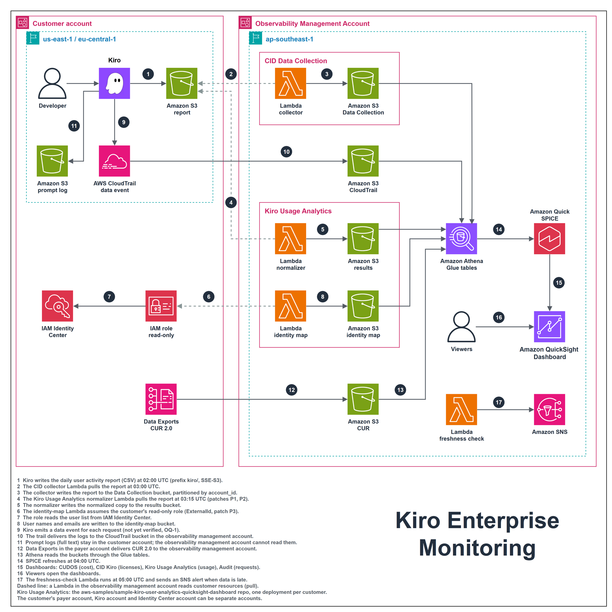

# Kiro Enterprise Monitoring

A design for monitoring how a customer's organization uses [Kiro](https://kiro.dev/), with every dashboard hosted in one central **observability management account**. The design combines three dashboards AWS already publishes with two log sources:

| Layer | Component | Question it answers | Data source |
|---|---|---|---|
| 1 | CUDOS, Kiro section | What does Kiro cost per month and per account? | CUR 2.0 |
| 2 | [CID Kiro User Activity Dashboard](https://docs.aws.amazon.com/guidance/latest/cloud-intelligence-dashboards/kiro-user-activity-dashboard.html) | Which licenses are paid for but idle, and who should move to another tier? | CUR 2.0 and the Kiro user activity report |
| 3 | Kiro Usage Analytics ([aws-samples/sample-kiro-user-analytics-quicksight-dashboard](https://github.com/aws-samples/sample-kiro-user-analytics-quicksight-dashboard)) | Who uses Kiro, whose usage is dropping, and which models are chosen? | Kiro user activity report |
| 4 | CloudTrail data events | Which request was made, by whom, when, and did it fail? | A trail that records data events only |
| 5 | Kiro prompt logging | What was asked and answered (audit only) | Prompt log bucket, kept in the customer account |

**Status: design only. No AWS resource has been created.** The requirements, the design and the task plan are in [`.kiro/specs/kiro-customer-monitoring/`](.kiro/specs/kiro-customer-monitoring/).

## Architecture



1. Kiro writes the daily user activity report (CSV) at 02:00 UTC (prefix `kiro/`, SSE-S3).
2. The CID collector Lambda pulls the report at 03:00 UTC.
3. The collector writes the report to the Data Collection bucket, partitioned by `account_id`.
4. The Kiro Usage Analytics normalizer Lambda pulls the report at 03:15 UTC (patches P1, P2).
5. The normalizer writes the normalized copy to the results bucket.
6. The identity-map Lambda assumes the customer's read-only role (ExternalId, patch P3).
7. The role reads the user list from IAM Identity Center.
8. User names and emails are written to the identity-map bucket.
9. Kiro emits a data event for each request (not yet verified, OQ-1).
10. The trail delivers the logs to the CloudTrail bucket in the observability management account.
11. Prompt logs (full text) stay in the customer account; the observability management account cannot read them.
12. Data Exports in the payer account delivers CUR 2.0 to the observability management account.
13. Athena reads the buckets through the Glue tables.
14. SPICE refreshes at 04:00 UTC.
15. Dashboards: CUDOS (cost), CID Kiro (licenses), Kiro Usage Analytics (usage), Audit (requests).
16. Viewers open the dashboards.
17. The freshness-check Lambda runs at 05:00 UTC and sends an SNS alert when data is late.

A dashed line means a Lambda in the observability management account reads a customer resource (pull). The customer's payer account, Kiro account and Identity Center account can be separate accounts.

## Design points

- **Pull, not push.** Kiro writes the activity report and the prompt log only to a bucket in the account where users are subscribed; Kiro does not support a bucket in another account. Lambdas in the observability management account read the customer's report bucket, and the customer only adds a bucket policy.
- **The report bucket must use SSE-S3 under the `kiro/` prefix.** The CID collector does not support SSE-KMS source buckets, and the Data Collection Stack does not pass a prefix to the Kiro module, so the module default `kiro/` always applies.
- **Prompt text never leaves the customer account.** An optional Lambda in the customer account can forward an allow-listed set of metadata fields (IDs, timestamps, lengths), never the prompt or response text.
- **One Kiro Usage Analytics deployment per customer.** The sample has no account column, so customers would mix in one deployment. Running it in the observability management account needs three small patches:
  - P1: make the report path take a source account instead of the deploying account.
  - P2: turn the preflight bucket check into a warning when the bucket belongs to another account.
  - P3: pass an ExternalId when the identity-map Lambda assumes the customer's role.
- **Only the cost layers have history.** CUR can be backfilled for up to 14 months; the activity report, CloudTrail and prompt logs start on the day they are enabled.

## Open questions

These must be measured before the related layers are built. Each one has a task in [`tasks.md`](.kiro/specs/kiro-customer-monitoring/tasks.md):

| ID | Question |
|---|---|
| OQ-1 | Does Kiro emit CloudTrail data events of type `AWS::CodeWhisperer::Profile`, which event names, and how many per chat message? |
| OQ-2 | Does the CloudTrail `requestID` match the `requestId` in the prompt log? |
| OQ-3 | Do the user IDs in the activity report, CloudTrail and the prompt log share one format? |
| OQ-7 | Do CUDOS and CID work on a CUR export filtered to Kiro line items only? |
| OQ-11 | Can a trail in the Kiro profile Region deliver to a bucket in another Region? |

The full list (OQ-1 to OQ-13) and the decisions still open (D1 to D8) are in [`design.md`](.kiro/specs/kiro-customer-monitoring/design.md).

## Repository layout

| Path | Content |
|---|---|
| `.kiro/specs/kiro-customer-monitoring/requirements.md` | 19 requirements, 96 acceptance criteria in EARS notation (Vietnamese) |
| `.kiro/specs/kiro-customer-monitoring/design.md` | Architecture, evidence from AWS docs and source code, patches, data models, decisions, open questions (Vietnamese) |
| `.kiro/specs/kiro-customer-monitoring/tasks.md` | Implementation tasks with owner, dependencies and a measurable done check (Vietnamese) |
| `diagrams/kiro-customer-monitoring.drawio` | The architecture diagram above, edited by hand in draw.io |
| `diagrams/kiro-customer-monitoring.png` | PNG export of that diagram, used in this README |
| `diagrams/kiro-customer-monitoring-chi-tiet.drawio` | Detailed two-page diagram with notes (data flow, cross-account permissions), generated |
| `diagrams/build_architecture.py`, `diagrams/drawio_lib.py` | Generator for the detailed diagram, with a geometry check |
| `diagrams/verify_drawio.py` | Independent diagram check: XML, dangling edges, AWS4 icon names, note fit, page bounds |
| `LICENSE` | MIT License |
| `vendor/sample-kiro-user-analytics-quicksight-dashboard/` | The layer 3 sample at upstream commit `1f5f5b8` (MIT-0), plus patches P1-P3 for a report bucket in another account and an ExternalId on the Identity Center role |
| `vendor/PATCHES.md` | Upstream pin, SHA256 of patched files, every patched line, test results before and after |
| `tools/survey_customer.py` | Read-only survey of a customer's accounts. Stops before any other call if a profile is not the expected account |
| `tools/measure_oq.py` | Measures the open questions from temporary buckets. Prints only counts and ID shapes, never content |
| `tools/scan_staged.py` | Blocks account IDs, Identity Store IDs, `ssoins-` IDs, customer names and em dashes in `*.tf` from commits |
| `infra/observability/freshness/` | Terraform module and Lambda for the daily freshness check and SNS alert |
| `customers/_template/` | Empty customer config. Every other folder under `customers/` is gitignored |
| `docs/customer-config.md`, `docs/data-inventory-template.md` | Config field rules, and the data inventory the customer signs per layer |

## Offline checks

None of these need AWS credentials.

```bash
python -m unittest discover -s tools/tests
python -m unittest discover -s infra/observability/freshness/tests
cd vendor/sample-kiro-user-analytics-quicksight-dashboard && PYTHONPATH=tests python -m unittest discover -s tests
python tools/scan_staged.py   # on what is staged for commit
```

## Working with the diagrams

Export the main diagram to PNG after editing it (draw.io desktop CLI):

```bash
draw.io --export --format png --scale 2 --border 20 \
  --output diagrams/kiro-customer-monitoring.png diagrams/kiro-customer-monitoring.drawio
```

Regenerate the detailed diagram (the script never writes the hand-edited main diagram):

```bash
python diagrams/build_architecture.py
```

Verify a diagram against draw.io's AWS4 icon library:

```bash
curl -o Sidebar-AWS4.js https://raw.githubusercontent.com/jgraph/drawio/dev/src/main/webapp/js/diagramly/sidebar/Sidebar-AWS4.js
python diagrams/verify_drawio.py diagrams/kiro-customer-monitoring-chi-tiet.drawio Sidebar-AWS4.js
```

The main diagram reports one icon, `quicksight`, as missing from the current library. The icon is used on purpose and renders in the draw.io version used to edit the diagram.

## References

- [Kiro: viewing per-user activity](https://kiro.dev/docs/enterprise/monitor-and-track/user-activity/)
- [Kiro: logging user prompts](https://kiro.dev/docs/enterprise/monitor-and-track/prompt-logging/)
- [CID: Kiro User Activity Dashboard](https://docs.aws.amazon.com/guidance/latest/cloud-intelligence-dashboards/kiro-user-activity-dashboard.html)
- [CID: Data Exports (CUR 2.0 across accounts)](https://docs.aws.amazon.com/guidance/latest/cloud-intelligence-dashboards/data-exports.html)
- [AWS CloudTrail: logging data events](https://docs.aws.amazon.com/awscloudtrail/latest/userguide/logging-data-events-with-cloudtrail.html)
- [aws-samples/sample-kiro-user-analytics-quicksight-dashboard](https://github.com/aws-samples/sample-kiro-user-analytics-quicksight-dashboard)

## License

[MIT](LICENSE). The AWS dashboards and the sample this design builds on keep their own licenses.
